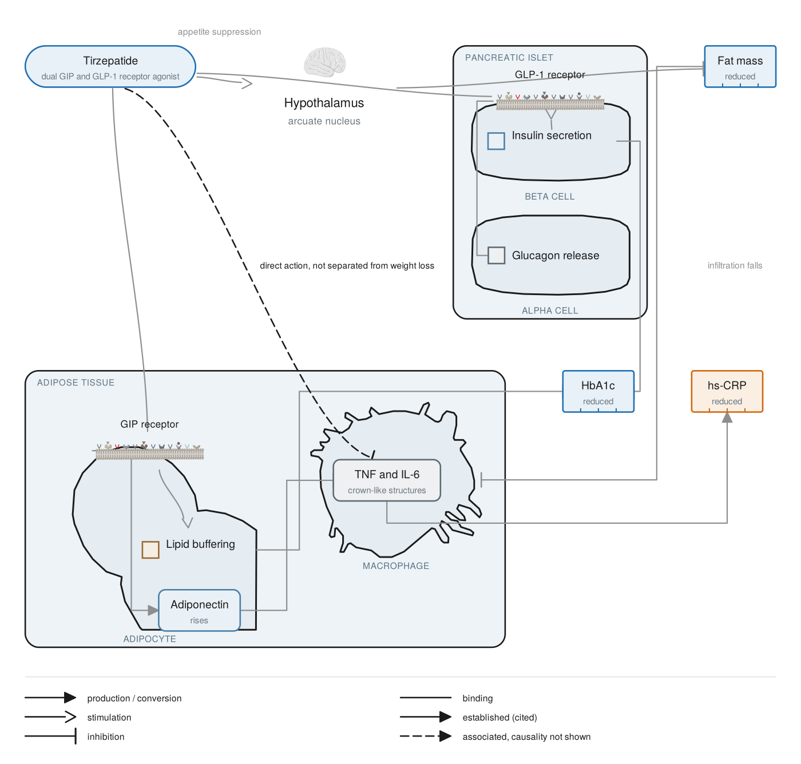

# all-research-skills

Skills for preparing a scientific manuscript, each self-contained in its own
folder with a `SKILL.md` entry point. Two so far, and they sit at the two ends
of the same problem: what a figure claims, and whether a citation is real.

Both are built on the same principle. A language model will complete a
plausible detail from memory, whether that detail is an author list or the
provenance of a drawing, and the completion survives every reading. Neither
skill lets it. A reference is matched against a retrieved record or marked
unverified; a relation in a figure carries the evidence level it was declared
with, and a pictorial asset resolves to a named entry in an open-licence
registry or is not drawn.

## bibliography-verification

Verifies every reference in a manuscript against PubMed before submission,
catching fabricated and mis-cited entries: the DOI that resolves to a real
paper while the authors, year, volume and pages belong to nothing; the right
paper at the wrong coordinates; the invented congress abstract.

The governing rule is one line: never fill in a bibliographic field you have
not retrieved in this session. Entries PubMed cannot see are separated out and
routed to their own source rather than passed, because that is where invented
identifiers hide. Nothing is repaired silently; the author signs the
bibliography and sees every change.

See [`bibliography-verification/`](bibliography-verification/).

## scientific-figures

A compiler for publication-grade schematic figures: mechanisms of action,
pathways, clinical algorithms, study designs and graphical abstracts. Figures
are written as a declarative specification and compiled to deterministic vector
output, so nothing passes through a generative image model and every figure is
reproducible from source.

Every relation carries a mandatory evidence level, rendered through a dedicated
visual channel, so a proposed mechanism cannot be drawn as a demonstrated one.
Every pictorial asset resolves against a registry of open-licensed libraries
under a licence gate enforced at compile time, and entities are depicted rather
than boxed: a receptor is a drawn receptor on a drawn membrane, and a cell that
holds something is drawn as a cell with the contents in its lumen.

See [`scientific-figures/`](scientific-figures/).

## Using them together

The order is the order of the work. Draft, then compile the figures from the
claims the draft actually makes, then verify the bibliography last, after the
references have stopped moving, since renumbering and merging are themselves a
source of error.

## Requirements

Python 3.9 or later. `scientific-figures` needs PyYAML for YAML specifications
and uses `cairosvg`, `python-pptx`, `scikit-image` and `scipy` for raster and
deck export and for derived geometry; JSON specifications compile to SVG on the
standard library alone. `bibliography-verification` is standard library only,
with `pandoc` needed for `.docx` input.

Neither bundles the services it talks to. The figure compiler fetches assets
from the open libraries it names, and the bibliography checker needs the PubMed
connector.

## Citing

`CITATION.cff` carries the metadata, and the archived versions have a DOI.
Please cite the version you used.

## Licensing

Code and reference text: MIT, see `LICENSE`. Figures and plates are CC BY 4.0;
see `scientific-figures/LICENSING.md` for the split. No third-party assets are
redistributed here: the registry holds metadata only.
