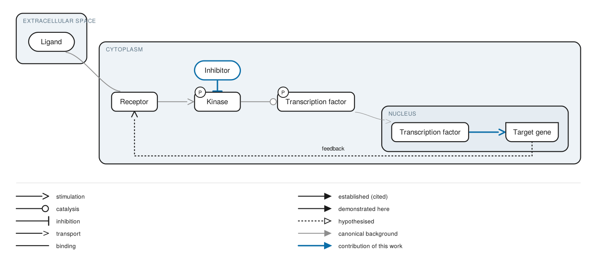

# scientific-figures

A skill for building publication-grade schematic figures: mechanisms of action, pathways, clinical algorithms, study designs, reporting flow diagrams and graphical abstracts.

Three design decisions distinguish it from an illustration tool.

**It is a compiler, not a generator.** Figures are written as a declarative specification (`schema/figure-spec.schema.json`) and compiled to deterministic vector output. One source produces the journal variant, the slide variant and the thumbnail. Nothing passes through a generative image model, which keeps the output inside the 2026 publisher policies on AI imagery and makes every figure reproducible from source.

**It knows the epistemic status of what it draws.** Every relation carries a mandatory `evidence` field with values established, demonstrated here, associated or hypothesised, rendered through a dedicated visual channel. A proposed mechanism cannot be drawn as a demonstrated one by accident, and the caption draft is generated from the same field.

**It enforces licensing in code.** Every pictorial asset resolves to an entry in `assets/sources.json`, drawn from open libraries (Health Icons, Bioicons, NIH BioArt, SciDraw, PhyloPic, Open Science Art, Servier Medical Art, Reactome, WikiPathways). A licence gate refuses no-derivative, share-alike and non-commercial assets for publication targets, and refuses KEGG map images outright. The attribution block is generated, not remembered.

Start at `SKILL.md`.

## Quickstart

```bash
python render/figure_render.py examples/moa-example.yaml -o figure.svg --caption caption.md
python render/figure_render.py examples/moa-example.yaml --check      # validate only
```

Python 3.9 or later. PyYAML is needed only for YAML specs; JSON specs run on the standard library alone.



The figure above is compiled entirely from `examples/moa-example.yaml`, with no manual adjustment of the geometry. The dotted arc with the unfilled head is a proposed feedback; the solid blue arcs are what the work claims to show; everything grey is cited background.

## Status and limitations

Version 0.5, after two production runs and an analysis of four published exemplars. The renderer covers band B (mechanism of action, pathways, study designs, clinical algorithms). Band A, the standard-conformant reporting diagrams with their arithmetic validator, and band C, the journal-dimensioned canvas, are specified in `references/01-figure-taxonomy.md` but not yet implemented; the validator refuses a band A figure rather than improvising one.

New in 0.2: pictogram resolution against Bioicons and Health Icons, with a vector gate alongside the licence gate; one text-metrics function for every glyph; arcs diverted into a clear lane by geometric intersection rather than by rank distance; desaturation of canonical pictograms applied to colour values; a refusal message that names the binding constraint.

New in 0.5: a second layout engine. `anatomical` places an entity inside whatever contains it, so position carries location and the arcs carry causality; a container is just an entity with contents, so a macrophage holds a kinase and is still drawn as a macrophage. Anatomical identity comes from the open libraries as a faint anchor behind the contents, resolved by term, so the construct serves any field without a hand-drawn template. A local derivative store caches derived geometry and composed assets with the full licence chain. `flow` remains and is still right for algorithms.

New in 0.4: `meta.purpose` assigns the colour budget, so an explanatory review figure spends colour on entity identity instead of on a narrative-role channel it does not use; `qualifier` typography; `prominence` as a weight channel; neutral fills and a compartment tint ramp; label wrapping; pictograms bounded with their labels in one container; rows that follow real node heights; lane routing that tests the whole route and takes the shorter detour; and catalogue categories that cannot depict a biological entity are excluded, after "B cell" resolved to a drawing of the letter B.

New in 0.3.1: specificity now outranks source cleanliness in the resolver, two entities can no longer be drawn with one glyph, imported icons painted with currentColor are actually desaturated, and the background covers the whole canvas.

New in 0.3: a sixteen-class entity ontology organised by scale, separated from a depiction axis, so a clone is a `cell_population` and a resistance is a `measure` instead of both collapsing into `unspecified`; generic substitution governed by generalise-up-never-sideways with a curated per-class allow list; an adaptation ledger that records every derivative transformation and folds it into the credit line; built-in generic glyphs so no entity is drawn as an anonymous box; a vertical reading axis for decision procedures; and PPTX output with native shapes for the figures co-authors revise.

Known limits: arcs are routed without regard to containment, so a relation between two entities in different containers can cross a third; the anatomical engine lays interior contents out in rows rather than by any finer spatial sense; there is no phase or context partition, which three of the four exemplars use; there are no insets and no panels, which makes "split the figure" advice the tool cannot execute; NIH BioArt, SciDraw, Open Science Art and PhyloPic have no machine index wired and are resolved by hand through `asset:`; relation labels are placed without collision avoidance except on lane-routed and vertical-flow arcs; the PPTX export is not yet a faithful copy of the figure: routed arcs are flattened to straight connectors and the legend is not reproduced. Each deck now carries a visible note listing what it omits, and the exporter prints the same list, so an editable artefact cannot be mistaken for the figure of record.

## Citing

`CITATION.cff` carries the metadata. Please cite the version you used.

## Layout

```
SKILL.md                              entry point, hard rules, workflow
render/figure_render.py               spec to SVG compiler (band B)
references/01-figure-taxonomy.md      figure classes, normative bands, invariants
references/02-visual-lexicon.md       normative glyph vocabulary
references/03-journal-and-policy.md   target specifications, AI policy, accessibility
schema/figure-spec.schema.json        intermediate representation
assets/sources.json                   open asset registry and licence gate
assets/figure-lexicon-v0.1.svg        rendered reference plate
render/asset_resolver.py              pictogram resolution, licence and vector gates
examples/moa-example.yaml             worked specification
render/ontology.py                    entity classes, depiction, generic glyphs
render/layout_spatial.py              containment layout, slots, scale ladder
render/derive.py                      derived geometry and the derivative store
render/style.py                       the colour budget under each purpose
examples/anatomical-example.yaml      containment, boundary slots, anchors
render/figure_export.py               SVG, PNG and PPTX output
examples/pictogram-example.yaml       resolved pictograms and generic substitution
examples/algorithm-example.yaml       vertical clinical algorithm, PPTX output
examples/moa-example.journal.svg      its compiled output
CITATION.cff                          citation metadata
LICENSE / LICENSING.md                MIT for code, CC BY 4.0 for the plates
```
